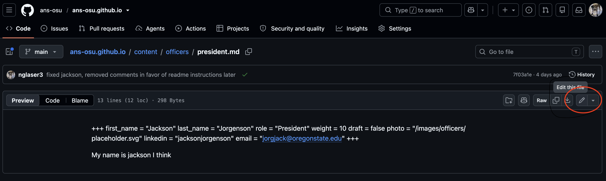
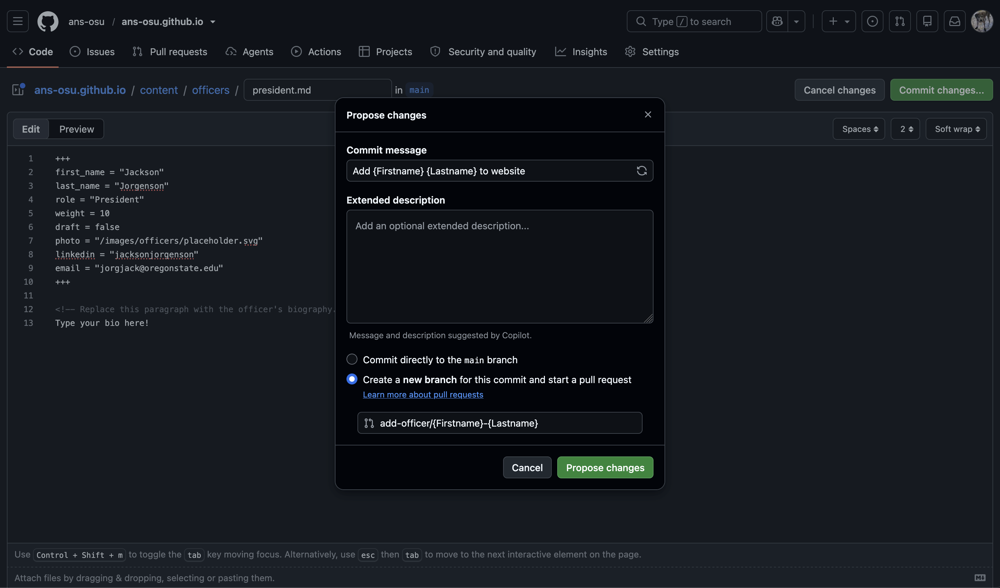
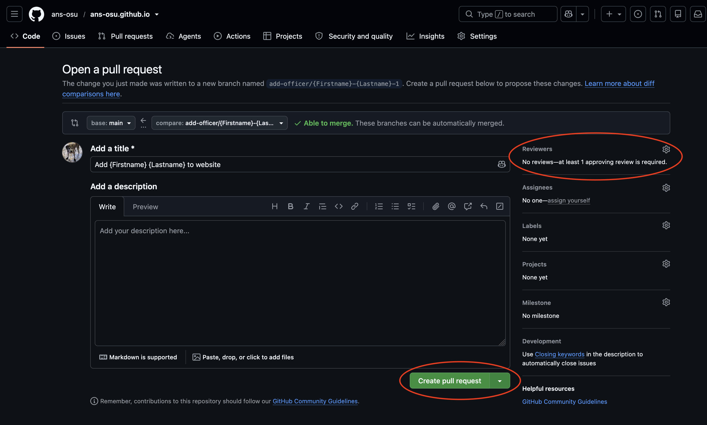
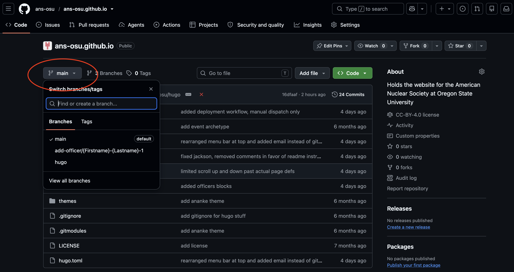
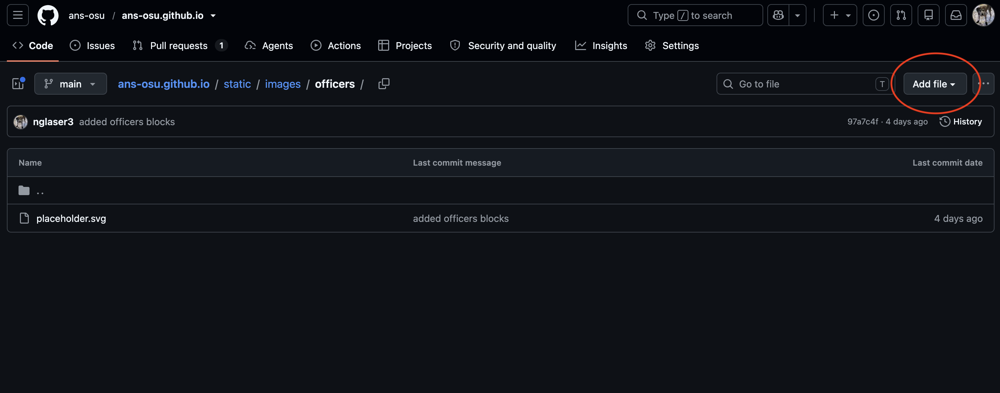

# Table of Contents
1. [Adding yourself to the website (using github website)](#adding-yourself-to-the-website)
2. [Adding an Event to the website (using github website)](#adding-an-event-to-the-website)
3. [Adding an Event "tag" (using the github website)](#adding-an-event-tag-to-the-website)

# Adding yourself to the website
To add yourself to the website, please follow these steps:
1. [Create a GitHub account](https://docs.github.com/en/account-and-profile/how-tos/account-management/creating-an-account-on-github)
2. Navigate to `content/officers/` and then click on your position. 
3. On the right of the screen, click on the pencil icon.

4. Update the following fields, and only the following fields:
- first_name
- last_name
- linkedin
- email
- photo: Set this to:
```yaml
photo = "/images/officers/{Firstname_Lastname}.{png/jpg/other}"
```
5. Add in your biography under the `<!-- Replace this paragraph with the officer's biography. -->`
6. In the top right, click the big green button for `Commit Changes...`, to get to the following screen, and fill out as so:

7. Click `Propose Changes`, and then on the new screen add `nglaser3` and/or `munkm` as reviewers. Then select `Create Pull Request`.

8. Click `<> Code` in the top left to navigate back to the code for the repository. Then, select the drop down arrow next to `main`, and select the branch you just created.

9. Navigate to `static/images/officers/`, and click `Add file` and `Upload files`:

9. Upload your headshot, and select `Commit changes`
10. Done!

# Adding an Event to the Website
1. Navigate to `contents/events/`. 
2. Select `Add file` then `Create new file`.
3. Name the file whatever you would like, then copy the following into the body of the file:
```yaml
+++
title = '{Title}'
draft = false

event_date = "{Month} {Day}, {Year}"
start_time = "{Hour}:{Minute}"
end_time = "{Hour}:{Minute} {A.M./P.M.}"
location = "{Room Number} {Building}"

<!-- delete this line if no food -->
food = "{Food included}" 

<!-- Optional tags are listed in the README.md-->
tags = ["{Tag}", "{Tag}"]
+++

## Description 
<!-- Brief summary describing the event -->
{Description}
```
4. Fill out the information inclosed with `{}`, and delete the brackets.
- Allowable event tags are available in [the next section](#adding-an-event-tag-to-the-website)
5. Commit changes and create a pull request

# Adding an Event Tag to the Website
1. Navigate to `layouts/events/summary.html`.
2. Look for the following code block:
```html
    {{ $tagColors := dict
      "general-meeting" "#003B5C"
      "social" "#4A773C"
      "outreach" "#D3832B"
      "professional-development" "#7A6855"
    }}
```
3. Add a new line for the tag and the hexcode of the desired color. For help selecting a hexcode, you can visit [this website](https://htmlcolorcodes.com/). For example, adding a tag to be displayed with pink as "Important Event", the following would suffice:
```html
    {{ $tagColors := dict
      "general-meeting" "#003B5C"
      "social" "#4A773C"
      "outreach" "#D3832B"
      "professional-development" "#7A6855"
      "important-event" "#d15abf"
    }}
```
4. Commit changes and create a pull request.